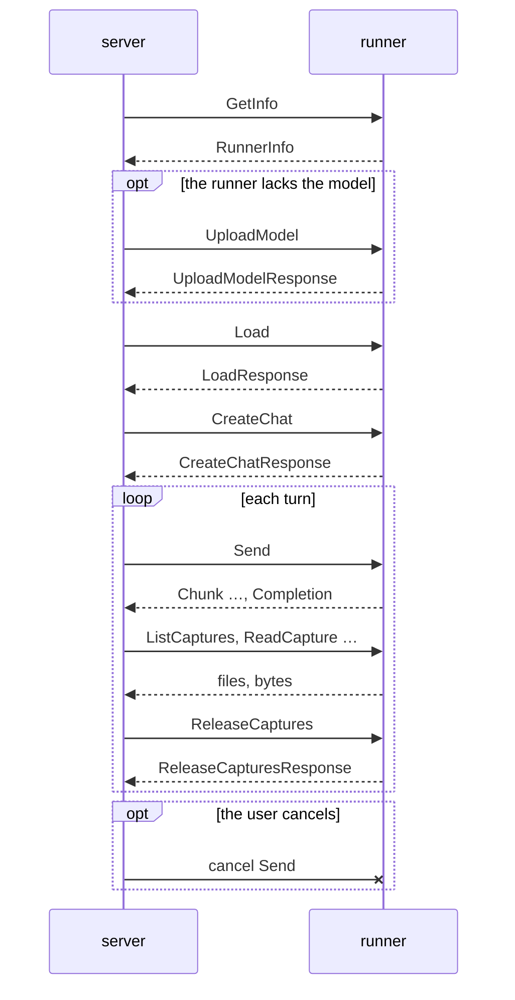

# Model Debugger Protocol 1.0.0

This document specifies the protocol between the Model Debugger server and a
runner. Over one gRPC connection, the server loads a model on the runner,
conducts a single chat with it, and retrieves the tensors the runtime
captures during generation.

The RPCs and messages are defined in `model_debugger/v1/runner.proto`,
with each field's rule in its comment. This file holds the terms and the
rules that span RPCs.

## Terminology

- **runtime**: a library that runs a model, LiteRT-LM or PyTorch
- **runner**: a process that hosts a runtime and serves the `Runner` service
- **server**: the process that connects to runners and calls their RPCs
- **model**: a model file, identified by its sha256
- **chat**: the one conversation of a connection, whose context the runner keeps
- **chat message**: an entry of a chat's `messages`, what a user or the model said
- **turn**: one exchange of a chat, the user's chat message and the model's reply
- **capture**: the tensor files a runtime records while generating a turn

## Transport

The protocol is a gRPC service, `model_debugger.v1.Runner`, over HTTP/2. The
runner is the gRPC server, listening on a TCP port; the Model Debugger server
is the gRPC client. How the client obtains the address is out of scope.

A runner serves only its first client, for its whole life: the connection
of the first RPC is the session's, and an RPC on any other connection fails
with `FAILED_PRECONDITION`, a reconnection of the same server included. The
client therefore keeps that one connection for the whole session and must
not let gRPC close it when idle (gRPC's `grpc.client_idle_timeout_ms`
closes an idle channel after 30 minutes by default). Another session is
another runner.

Errors are gRPC statuses with the canonical codes; each RPC's comment names
the codes it returns. `INVALID_ARGUMENT` is a request refused for what it
holds; `FAILED_PRECONDITION` is a request the runner cannot serve in its
state: another client's, a second `Load` or `CreateChat`, one while another
is in progress, or a device this runner cannot run on; `INTERNAL` is a
failure of the runner or its runtime. Cancelling an RPC is the only way to
stop it.

## Lifecycle



`GetInfo` comes first; the server goes on only if `protocol_version` is its
own. A model is named by its sha256; a `Load` the runner answers with
`NOT_FOUND`, which means only that its model store has no file of that
sha256, is followed by `UploadModel` and tried again. A session holds one
model and one chat: a second `Load` or `CreateChat`, or any `Load`,
`CreateChat` or `Send` while one of its kind is in progress, fails with
`FAILED_PRECONDITION`. Once the server holds every file of a turn's capture
it releases it, and the runner deletes it: captures are large, and a runner
keeps only those not yet released. Cancelling `Send` stops the model and ends
the chat; so does any other failure of `Send` but `INVALID_ARGUMENT`, since
the model may then hold a turn the server never got. Nothing more is
generated in this session. Another model or another conversation is another
session, on another runner.

Runners on one machine may share a model store, and the server uploads a
model to one runner at a time: two uploads of one model may not overlap,
since the runners they reach may share the store. Once an upload succeeds, a
`Load` on any runner sharing the store finds the model.

### Example

The runner lacks the model and receives it, the model is loaded, the user asks
two questions, the server reads the captures of each, the user cancels a
third. Each line is one RPC; the fields shown are the ones that matter here.

```
GetInfo      → RunnerInfo {protocol_version: "1.0.0", host: {platform: MACOS, …}, runtime: {name: LITERT_LM, …}}
Load         {sha256: "9f3a…", device: GPU, context_length: 4096}
             ✕ NOT_FOUND                                               the runner's store lacks it
UploadModel  {header: {sha256: "9f3a…", size: 3100000000}}, {data: …} × n
             → UploadModelResponse {}
Load         {sha256: "9f3a…", device: GPU, context_length: 4096}
             → LoadResponse {start_token: 2, stop_tokens: [{ids: [1]}, {ids: [106]}]}
CreateChat   {options: {max_completion_tokens: 32, top_k: 1}}
             → CreateChatResponse {}
Send         {message: {role: USER, content: "What is 2 + 2?"}}
             → Chunk {content: "It is"}
             → Chunk {content: " 4."}
             → Completion {content: "It is 4.", finish_reason: STOP,
                           usage: {prompt_tokens: 14, completion_tokens: 3, total_tokens: 17},
                           model_debugger: {turn: 1, prompt_tokens: [{id: 2364, text: "<|turn>"}, …], context_token_count: 17}}
ListCaptures {turn: 1}
             → ListCapturesResponse {files: [{path: "decode_post_logits_step_0.safetensors", size: 1050000, sha256: "…"}, …]}
ReadCapture  {turn: 1, path: "decode_post_logits_step_0.safetensors"}
             → CaptureData {data: …} × n
ReadCapture  … for every other file listed, generated_tokens.jsonl included
ReleaseCaptures {turn: 1}                                             every file read and checked
             → ReleaseCapturesResponse {}
Send         {message: {role: USER, content: "Times 3?"}}          the chat keeps the first turn
             → Chunk …, Completion {… model_debugger: {turn: 2, …}}
ListCaptures {turn: 2} …, ReleaseCaptures {turn: 2}
Send         {message: {role: USER, content: "Count from 1 to 100."}}
             → Chunk {content: "1, 2, 3"}
             ✕ cancelled by the server                                the chat is over
```

## Changing the protocol

The package name carries the major version, `model_debugger.v1`. Within it,
a change may only add fields, enum values or RPCs, never remove, rename or
renumber; such a change raises MINOR. A change that breaks a client or a
server is a new package, `v2`, and raises MAJOR. The version is written in
the proto's header and in this file's title, and a runner reports it as
`protocol_version`; the server accepts only its own. A released version is a
git tag, `v1.0.0`.
