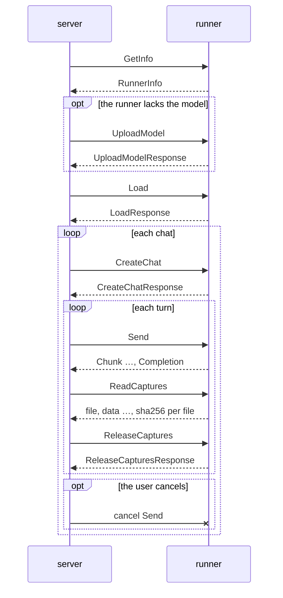

# Model Debugger Protocol 1.0.0

The protocol between the Model Debugger server and a runner: the server loads
a model on the runner, holds a chat with it, one at a time, and reads the
tensors the runtime captures while it generates.

The RPCs, messages and error codes are defined in
`model_debugger/protocol/runner.proto`, each with its rule in its comment.
This file holds the terms and what spans RPCs.

## Terminology

- **runtime**: a library that runs a model, LiteRT-LM or PyTorch
- **runner**: a process that hosts a runtime and serves the `Runner` service
- **server**: the process that connects to runners and calls their RPCs
- **model**: a model file, identified by its sha256
- **chat**: a conversation on a runner, whose context the runner keeps; a
  runner has one at a time
- **turn**: one exchange of a chat, the user's message and the model's reply
- **capture**: the tensor files a runtime records while generating a turn

## Transport

The protocol is a gRPC service, `model_debugger.protocol.Runner`, over
HTTP/2. The runner is the gRPC server, listening on a TCP port; the Model
Debugger server is the client. How the client finds the address is out of
scope.

A runner keeps no client identity: any connection may call any RPC, and a
client may reconnect. Losing the connection an RPC is on cancels that RPC,
and a deadline that passes counts as a cancel: the client then sees
`DEADLINE_EXCEEDED` or `CANCELLED`. `UNAVAILABLE` never comes from a runner;
gRPC gives it for a runner that cannot be reached. Only stopping the runner
process stops everything at once.

## Lifecycle



`GetInfo` comes first. A `Load` answered with `NOT_FOUND` is followed by
`UploadModel` and tried again. A runner holds one model for its whole life
and tries to load it once; another model is another runner. It holds one chat
at a time: a `CreateChat` closes the chat there is, deleting its captures not
yet released, before it creates the next, whose turns count from 1 again.
Once the server holds every file of a turn's capture it releases it, since
captures are large. A cancelled or failed `Send` ends the chat (`Send`'s
comment says which failures do not), and after a reply that filled the
context the next `Send` fails with `RESOURCE_EXHAUSTED` (`"tokens-left": "0"`);
nothing more is generated in that chat, and a `CreateChat` starts another.

Runners on one machine may share a model store, so the server uploads a model
to one runner at a time. The store keeps one model: an `UploadModel` or a
`Load` first deletes every other one but those a live runner uses, the one it
loaded or else was last given or asked for. Once an upload succeeds, a `Load`
on any runner sharing the store finds the model, as long as the runner that
received it lives and is given or asked for no other.

### Example

The runner lacks the model and receives it, the model is loaded, the user asks
two questions, the server reads the captures of each, the user cancels a
third and starts a new chat. Each line is one RPC; the fields shown are the
ones that matter here.

```
GetInfo      → RunnerInfo {protocol_version: "1.0.0",
                           host: {platform: MACOS, …},
                           runtime: {name: LITERT_LM, …}}
Load         {sha256: "9f3a…", device: GPU, context_length: 4096}
             ✕ NOT_FOUND
               (the runner's store lacks it)
UploadModel  {header: {sha256: "9f3a…", size: 3100000000}}, {data: …} × n
             → UploadModelResponse {}
Load         {sha256: "9f3a…", device: GPU, context_length: 4096}
             → LoadResponse {start_token: 2,
                             stop_tokens: [{ids: {ids: [1]}},
                                           {ids: {ids: [106]}}]}
CreateChat   {options: {max_completion_tokens: 32, top_k: 1}}
             → CreateChatResponse {}
Send         {message: {role: USER, content: "What is 2 + 2?"}}
             → Chunk {content: "It is"}
             → Chunk {content: " 4."}
             → Completion {
                 content: "It is 4.", finish_reason: FINISH_REASON_STOP,
                 usage: {prompt_tokens: 14, completion_tokens: 3,
                         total_tokens: 17},
                 model_debugger: {
                   turn: 1, context_token_count: 17,
                   fed_tokens: [
                     {position: 0, phase: PREFILL, id: 2, text: "<bos>"},
                     {position: 1, phase: PREFILL, id: 105,
                      text: "<|turn>"}, …,
                     {position: 13, phase: DECODE, id: 107, text: "\n"}, …]}}
ReadCaptures {turn: 1}
             → CaptureChunk {file: {
                 path: "decode_post_logits_step_0.safetensors",
                 size: 1050000}}
             → CaptureChunk {data: …} × n
             → CaptureChunk {sha256: "…"}
             → … the same for every other file, generated_tokens.jsonl
               included
ReleaseCaptures {turn: 1}
             (every file received and checked)
             → ReleaseCapturesResponse {}
Send         {message: {role: USER, content: "Times 3?"}}
             (the chat keeps the first turn)
             → Chunk …, Completion {… model_debugger: {turn: 2, …}}
ReadCaptures {turn: 2} …, ReleaseCaptures {turn: 2}
Send         {message: {role: USER, content: "Count from 1 to 100."}}
             → Chunk {content: "1, 2, 3"}
             ✕ cancelled by the server
               (the chat is over)
CreateChat   {messages: [{role: SYSTEM, content: "Be brief."}],
              options: {max_completion_tokens: 32, top_k: 1}}
             (closes the chat that is over)
             → CreateChatResponse {}
Send         {message: {role: USER, content: "Hi."}}
             → Chunk …, Completion {… model_debugger: {turn: 1, …}}
               (from an empty context again)
```

## Changing the protocol

The package is `model_debugger.protocol`. The version is the file option
`(protocol_version)` in `runner.proto`, now `1.0.0`. A runner reports it in
`GetInfo` as `protocol_version`, and the server accepts only a runner of
exactly its own version. A runner built before the package was renamed from
`model_debugger.v1` answers `GetInfo` with `UNIMPLEMENTED`, and the server
says the runner speaks another protocol.
